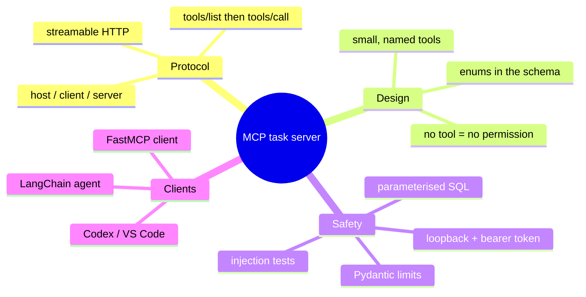

# Learning Guide — build an MCP task server yourself, in 12 steps

Type the code yourself. Run each check before moving on. One step a day is a fine pace.
The finished, tested version of every file is in this repo, so you can compare when you are stuck.


| Step | You build | You can prove it by |
|---|---|---|
| 1 | Project with uv | `uv run python --version` shows 3.12 |
| 2 | `tasks` table | `init_db()` twice, no error |
| 3 | `save_task`, `get_all_tasks` | A saved row comes back with defaults |
| 4 | `update_status` + not-found | Unknown id raises `TaskNotFoundError` |
| 5 | FastMCP server with `create_task` | In-memory client lists one tool |
| 6 | `list_tasks`, `update_task_status` | Three tools, round trip works |
| 7 | Pydantic limits and enums | Bad input is refused with a clear message |
| 8 | Streamable HTTP on port 8000 | Server log shows `http://127.0.0.1:8000/mcp` |
| 9 | `client.py` | Prints tools, create, update, list |
| 10 | `langchain_client.py` | Offline agent answers in a chat loop |
| 11 | Codex and VS Code config | IDE agent lists your tasks |
| 12 | pytest suite + bearer token | <!-- tests:51 -->51 tests pass |

---

## Step 1 — Set up the project

**Goal:** an isolated Python 3.12 project with locked dependencies.

**Commands**

```bash
mkdir mcp-task-server && cd mcp-task-server
uv init --python 3.12 --bare
uv add "fastmcp>=3.4,<4" "mcp>=1.24,<2" pydantic langchain langchain-mcp-adapters langgraph langchain-openai
uv add --dev pytest pytest-asyncio ruff
```

**What each part does**

- `uv init --bare` writes only `pyproject.toml`; no sample files to delete.
- `--python 3.12` pins the interpreter; uv downloads it if you do not have it.
- `"mcp>=1.24,<2"` matters: at the time of writing, `langchain-mcp-adapters` still imports the 1.x SDK, so the
  2.x SDK breaks it. Pinning both FastMCP and the SDK keeps them compatible.
- `uv add` updates `pyproject.toml` **and** `uv.lock`, so everyone gets the same versions.

**Verify:** `uv run python --version` → `Python 3.12.x`.

**Common errors**

| You see | Why | Fix |
|---|---|---|
| `No module named 'mcp.server.fastmcp' ... This is mcp 2.x` | The 2.x MCP SDK got installed next to an adapter that needs 1.x | Pin `mcp>=1.24,<2` and `fastmcp<4`, then `uv sync` |
| `uv: command not found` | uv not installed | `curl -LsSf https://astral.sh/uv/install.sh \| sh` |

---

## Step 2 — Create the tasks table

**Goal:** a SQLite table whose rules are enforced by the database itself.

**Code to type** (`database.py`, first part)

```python
import os, sqlite3
from contextlib import closing
from pathlib import Path

SCHEMA = """
CREATE TABLE IF NOT EXISTS tasks (
    task_id     TEXT PRIMARY KEY,
    title       TEXT NOT NULL CHECK (length(title) BETWEEN 1 AND 120),
    description TEXT NOT NULL DEFAULT '' CHECK (length(description) <= 1000),
    priority    TEXT NOT NULL DEFAULT 'medium' CHECK (priority IN ('low','medium','high')),
    status      TEXT NOT NULL DEFAULT 'todo' CHECK (status IN ('todo','in_progress','done')),
    created_at  TEXT NOT NULL DEFAULT (strftime('%Y-%m-%dT%H:%M:%SZ','now'))
)"""


def default_db_path() -> Path:
    return Path(os.environ.get("TASKS_DB_PATH", "tasks.db"))


def _connect(db_path=None):
    conn = sqlite3.connect(str(db_path or default_db_path()))
    conn.row_factory = sqlite3.Row
    return conn


def init_db(db_path=None):
    with closing(_connect(db_path)) as conn, conn:
        conn.execute(SCHEMA)
```

**What each part does**

- `TEXT PRIMARY KEY` — we will store a uuid4 string, so ids cannot be guessed or collide.
- `CHECK (status IN ...)` — even raw SQL cannot store `archived`. This is the last line of defence.
- `IF NOT EXISTS` — makes `init_db` safe to call on every start.
- `row_factory = sqlite3.Row` — rows behave like dicts, so `dict(row)` gives clean JSON later.
- `closing(...)` closes the file; the second `conn` in the `with` commits on success and rolls back on error.
- `TASKS_DB_PATH` — lets tests use a temporary file instead of your real one.

**Verify**

```bash
uv run python -c "import database as d; d.init_db(); d.init_db(); print('ok')"
```

**Common errors**

| You see | Why | Fix |
|---|---|---|
| `sqlite3.OperationalError: near "...": syntax error` | A missing comma between columns | Each column line except the last ends with `,` |
| A stray `tasks.db` in git | Database file committed | Add `*.db` to `.gitignore` |

---

## Step 3 — Save and list tasks

**Goal:** insert a task and read all tasks back, using placeholders only.

**Code to type** (append to `database.py`)

```python
def save_task(task_id, title, description="", priority="medium", db_path=None) -> dict:
    with closing(_connect(db_path)) as conn, conn:
        conn.execute(
            "INSERT INTO tasks (task_id, title, description, priority, status) VALUES (?, ?, ?, ?, 'todo')",
            (task_id, title, description, priority),
        )
        row = conn.execute("SELECT * FROM tasks WHERE task_id = ?", (task_id,)).fetchone()
    return dict(row)


def get_all_tasks(db_path=None) -> list[dict]:
    with closing(_connect(db_path)) as conn:
        rows = conn.execute("SELECT * FROM tasks ORDER BY created_at, rowid").fetchall()
    return [dict(r) for r in rows]
```

**What each part does**

- `?` placeholders — the driver sends values separately from the SQL text, so a title like
  `x'); DROP TABLE tasks; --` is stored as plain text. Never build SQL with f-strings.
- `'todo'` is written in the SQL, not taken from the caller — new tasks cannot start as `done`.
- `ORDER BY created_at, rowid` — stable order even when two tasks share the same second.

**Verify**

```bash
uv run python -c "import database as d; d.init_db(); print(d.save_task('t1','Cooking')); print(d.get_all_tasks())"
```

You should see `priority: 'medium'` and `status: 'todo'` filled in. Delete `tasks.db` afterwards.

**Common errors**

| You see | Why | Fix |
|---|---|---|
| `ProgrammingError: Incorrect number of bindings supplied. The current statement uses 1, and there are 3 supplied.` | You wrote `(task_id)` instead of `(task_id,)`. Without the comma it is a string, and Python treats each character as a value | Always add the trailing comma for a one-value tuple |
| `IntegrityError: UNIQUE constraint failed` | Same `task_id` twice | Generate ids with `uuid.uuid4()` (step 5) |

---

## Step 4 — Update status, with a clear "not found"

**Goal:** change only the `status` column, and fail loudly when the id does not exist.

**Code to type**

```python
VALID_STATUSES = ("todo", "in_progress", "done")


class TaskNotFoundError(LookupError):
    pass


def update_status(task_id, status, db_path=None) -> dict:
    if status not in VALID_STATUSES:
        raise ValueError(f"status must be one of {VALID_STATUSES}")
    with closing(_connect(db_path)) as conn, conn:
        cur = conn.execute("UPDATE tasks SET status = ? WHERE task_id = ?", (status, task_id))
        if cur.rowcount == 0:
            raise TaskNotFoundError(f"No task with id {task_id!r}")
        row = conn.execute("SELECT * FROM tasks WHERE task_id = ?", (task_id,)).fetchone()
    return dict(row)
```

**What each part does**

- `SET status = ?` — the function physically cannot touch title or description. Least privilege starts here.
- `cur.rowcount == 0` — an `UPDATE` that matches nothing is not an error in SQL; we make it one.
- A custom exception type lets the server turn it into a friendly message in step 6.

**Verify:** call `update_status("missing", "done")` and see `TaskNotFoundError`.

**Common errors:** forgetting the `rowcount` check means the agent is told "success" for a task that does not exist.

---

## Step 5 — Your first MCP tool

**Goal:** a FastMCP server with one tool, tested without any network.

**Code to type** (`server.py`, first version)

```python
import uuid
from fastmcp import FastMCP
import database as db


def build_server(db_path=None) -> FastMCP:
    mcp = FastMCP(name="task-server")
    db.init_db(db_path)

    @mcp.tool(name="create_task", description="Create a new task. It always starts with status 'todo'.")
    def create_task(title: str, description: str = "", priority: str = "medium") -> dict:
        """Give the task a random uuid4 id and save it."""
        return db.save_task(str(uuid.uuid4()), title, description, priority, db_path=db_path)

    return mcp
```

**What each part does**

- `build_server()` is a factory, so each test gets a fresh server with its own database.
- `@mcp.tool(...)` registers the function. FastMCP reads the type hints to produce the JSON Schema that
  clients see, and the `description` is what the model reads when deciding whether to call it.
- `uuid.uuid4()` — random, not sequential, so one user cannot guess another's ids.

**Verify** (in-memory client: no ports, no HTTP)

```python
# try_server.py
import asyncio
from fastmcp import Client
import server


async def main():
    async with Client(server.build_server("try.db")) as c:
        print([t.name for t in await c.list_tools()])
        print((await c.call_tool("create_task", {"title": "Cooking"})).data)


asyncio.run(main())
```

```bash
uv run python try_server.py
```

**Common errors**

| You see | Why | Fix |
|---|---|---|
| `RuntimeWarning: coroutine 'main' was never awaited` and nothing prints | You called `main()` instead of `asyncio.run(main())` | Wrap the entry point: `asyncio.run(main())` |
| `ModuleNotFoundError: No module named 'server'` | Running from another folder | Run from the project root or set `pythonpath` in pytest config |

---

## Step 6 — Add the other two tools

**Goal:** `list_tasks` and `update_task_status`, and a deliberate gap: no edit-description tool.

**Code to type** (inside `build_server`, after `create_task`)

```python
from typing import Literal
from fastmcp.exceptions import ToolError
Status = Literal["todo", "in_progress", "done"]

    @mcp.tool(name="list_tasks", description="List every task with its id, title, description, priority and status.")
    def list_tasks() -> list[dict]:
        """Return all tasks, oldest first."""
        return db.get_all_tasks(db_path=db_path)

    @mcp.tool(name="update_task_status", description="Change the status of one task. Only the status can change.")
    def update_task_status(task_id: str, status: Status) -> dict:
        """Set a new status, or fail clearly if the id does not exist."""
        try:
            return db.update_status(task_id, status, db_path=db_path)
        except db.TaskNotFoundError:
            raise ToolError("Task not found. Call list_tasks to see valid task ids.") from None
```

**What each part does**

- `status: Status` with `Literal[...]` becomes `"enum": ["todo","in_progress","done"]` in the schema, so a
  well-behaved model only ever sends one of those, and FastMCP rejects anything else before your code runs.
- `ToolError` sends `isError: true` with your message back to the client, instead of a stack trace.
- The error tells the model what to do next (`Call list_tasks`), which helps it recover on its own.
- **No `update_task_description` tool.** Not writing a tool is the strongest permission control you have.

**Verify:** list three tools; create a task, update it to `in_progress`, list it again.

**Common errors:** returning a `sqlite3.Row` instead of `dict(row)` — the client cannot serialise it.

---

## Step 7 — Validate inputs with Pydantic

**Goal:** limits that hold no matter which client calls the tool.

**Code to type**

```python
from typing import Annotated
from pydantic import BaseModel, ConfigDict, Field, ValidationError

Priority = Literal["low", "medium", "high"]


class NewTask(BaseModel):
    model_config = ConfigDict(extra="forbid", str_strip_whitespace=True)
    title: str = Field(min_length=1, max_length=120)
    description: str = Field(default="", max_length=1000)
    priority: Priority = "medium"

    @mcp.tool(name="create_task", description="Create a new task. It always starts with status 'todo'.")
    def create_task(
        title: Annotated[str, Field(description="Short task name, 1-120 characters")],
        description: Annotated[str, Field(description="Optional details, up to 1000 characters")] = "",
        priority: Annotated[Priority, Field(description="low, medium or high")] = "medium",
    ) -> dict:
        try:
            task = NewTask(title=title, description=description, priority=priority)
        except ValidationError as exc:
            fields = ", ".join(str(e["loc"][0]) for e in exc.errors())
            raise ToolError(f"Invalid input for field(s): {fields}") from None
        return db.save_task(str(uuid.uuid4()), task.title, task.description, task.priority, db_path=db_path)
```

**What each part does**

- `str_strip_whitespace=True` + `min_length=1` — a title of only spaces is refused.
- `max_length=120` — stops someone pasting a whole document into a title.
- `Annotated[..., Field(description=...)]` — per-argument help text the model reads.
- The error names the **field** but never repeats the **value**, so secrets pasted by mistake are not echoed.
- `extra="forbid"` plus FastMCP's `additionalProperties: false` — a call that sneaks in `"status": "done"` or
  `"description"` on `update_task_status` is refused.

**Verify:** `create_task` with `title=""` and with 121 characters both return `Invalid input for field(s): title`.

---

## Step 8 — Run it over streamable HTTP

**Goal:** a real server any client on your machine can reach.

**Code to type** (bottom of `server.py`)

```python
def main() -> None:
    host = os.environ.get("MCP_HOST", "127.0.0.1")
    port = int(os.environ.get("MCP_PORT", "8000"))
    build_server().run(transport="streamable-http", host=host, port=port)


if __name__ == "__main__":
    main()
```

**What each part does**

- `streamable-http` — one endpoint, `/mcp`, that handles requests and can stream server messages.
- `127.0.0.1` — only your machine can connect. `0.0.0.0` would expose it to your whole network.

**Commands**

```bash
uv run python server.py
```

**Verify:** the log shows `Starting MCP server 'task-server' with transport 'streamable-http' on http://127.0.0.1:8000/mcp`.

**Common errors**

| You see | Why | Fix |
|---|---|---|
| `[Errno 98] error while attempting to bind on address ('127.0.0.1', 8000): address already in use` | An old server is still running | `lsof -i :8000` then stop it, or `MCP_PORT=8001 uv run python server.py` |
| Browser at `/mcp` shows an error | Normal: it expects MCP JSON-RPC, not a page load | Use a client instead |

---

## Step 9 — A plain FastMCP client

**Goal:** call the tools directly, no model involved.

**Code to type** (`client.py`)

```python
import asyncio, os
from fastmcp import Client


async def demo(target):
    async with Client(target, auth=os.environ.get("MCP_AUTH_TOKEN")) as client:
        print("Tools:", ", ".join(t.name for t in await client.list_tools()))
        task = (
            await client.call_tool(
                "create_task",
                {"title": "Write MCP notes", "description": "Summarise transports", "priority": "high"},
            )
        ).data
        updated = (
            await client.call_tool(
                "update_task_status", {"task_id": task["task_id"], "status": "in_progress"}
            )
        ).data
        print("Updated:", updated["title"], updated["status"])
        for t in (await client.call_tool("list_tasks", {})).data:
            print(f"- {t['title']} [{t['priority']}] {t['status']}")


if __name__ == "__main__":
    asyncio.run(demo(os.environ.get("MCP_URL", "http://127.0.0.1:8000/mcp")))
```

**What each part does**

- `Client(url)` picks the HTTP transport from the URL; `Client(server_object)` would use in-memory.
- `async with` runs `initialize` on entry and closes the session on exit.
- `.data` is the parsed structured result; `.content` is the text version.
- `auth=` sends `Authorization: Bearer ...` only if you set a token (step 12).

**Verify:** with the server running in terminal 1, `uv run python client.py` in terminal 2 prints four lines.

**Common errors:** `httpx.ConnectError` — the server is not running or is on another port.

---

## Step 10 — A LangChain agent that uses the server

**Goal:** a chat loop where the model decides which MCP tool to call, with memory per conversation.

**Code to type** (`langchain_client.py`, core)

```python
from langchain.agents import create_agent
from langchain_mcp_adapters.tools import load_mcp_tools
from langgraph.checkpoint.memory import InMemorySaver


async def build_agent(session, model):
    tools = await load_mcp_tools(session)
    return create_agent(model, tools, system_prompt=SYSTEM_PROMPT, checkpointer=InMemorySaver())


async def ask(agent, text, thread_id="demo"):
    result = await agent.ainvoke(
        {"messages": [{"role": "user", "content": text}]}, config={"configurable": {"thread_id": thread_id}}
    )
    return result["messages"][-1].content
```

**What each part does**

- `load_mcp_tools(session)` — reads `tools/list` and wraps each MCP tool as a LangChain tool.
- `create_agent` — the standard tool-calling loop: model → tool → model … until a final answer.
- `InMemorySaver` + `thread_id` — the agent remembers earlier turns in the same thread.
- `pick_model()` — uses `ChatOpenAI` only if `OPENAI_API_KEY` is set; otherwise `FakeTaskModel`, a small
  rule-based stand-in (`fake_model.py`) that makes the same tool calls every time. That is what lets tests
  and CI run with no key.

**Verify**

```bash
uv run python langchain_client.py
you> add task Cooking
you> mark Cooking as done
you> change the description of Cooking to buy chicken
```

The last one is refused: there is no tool for it.

**Common errors**

| You see | Why | Fix |
|---|---|---|
| `OpenAIError: The api_key client option must be set` | Forced `ChatOpenAI` without a key | Unset the model override or export the key |
| Agent "forgets" the last turn | Different `thread_id` per call | Reuse the same `thread_id` |

---

## Step 11 — Connect Codex and VS Code

**Goal:** the same server, used by an IDE agent you did not write.

**VS Code** — `.vscode/mcp.json`:

```json
{ "servers": { "task-server": { "type": "http", "url": "http://127.0.0.1:8000/mcp" } } }
```

**Codex** — add to `~/.codex/config.toml`:

```toml
[mcp_servers.task-server]
url = "http://127.0.0.1:8000/mcp"
bearer_token_env_var = "MCP_AUTH_TOKEN"   # name of the variable, not the token
```

**Verify:** start the server, open the IDE agent, ask "list my tasks". You see the same rows the
LangChain agent created, because every client talks to the same server and database.

**Common errors:** the IDE shows the server as failed — start `server.py` first; HTTP servers are not
launched by the IDE the way stdio servers are. Details: [`docs/06-connect-codex-vscode.md`](docs/06-connect-codex-vscode.md).

---

## Step 12 — Tests and hardening

**Goal:** prove every rule with a test, and lock HTTP behind an optional token.

**Code to type** (token check in `server.py`)

```python
def bearer_auth_from_env():
    expected = os.environ.get("MCP_AUTH_TOKEN")
    if not expected:
        return None
    from fastmcp.server.auth.providers.debug import DebugTokenVerifier

    return DebugTokenVerifier(validate=lambda t: hmac.compare_digest(t.encode(), expected.encode()))
```

Pass it in: `build_server(auth=bearer_auth_from_env())`.

- `hmac.compare_digest` — constant-time compare, so timing does not leak how much of a guess was right.
- No token set → no auth, which is fine on loopback for learning.

**A test you should write first** (`tests/test_least_privilege.py`)

```python
async def test_update_status_rejects_smuggled_description(mcp):
    async with Client(mcp) as c:
        task = (await c.call_tool("create_task", {"title": "Cooking", "description": "buy chicken"})).data
        with pytest.raises(ToolError):
            await c.call_tool(
                "update_task_status", {"task_id": task["task_id"], "status": "done", "description": "changed"}
            )
        assert (await c.call_tool("list_tasks", {})).data[0]["description"] == "buy chicken"
```

**Commands**

```bash
uv run pytest                      # all tests
uv run python scripts/count_tests.py   # prints the real total
uv run ruff check .
```

**Verify:** <!-- tests:51 -->51 passed (measured on this repo).

**Common errors**

| You see | Why | Fix |
|---|---|---|
| `async def functions are not natively supported` | pytest-asyncio not active | `asyncio_mode = "auto"` in `[tool.pytest.ini_options]` |
| HTTP tests hang | Server subprocess never started | Check the port wait loop and that `server.py` runs on its own |

---

## What you learned



Next: [`docs/02-implementation-guide.md`](docs/02-implementation-guide.md) to adapt this for your own system.
