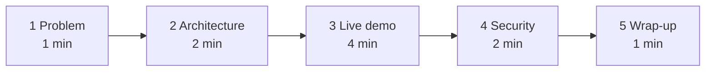

# Presentation guide — 10 minutes

Use this for an interview walkthrough or a team demo. Have two terminals and this README open.



## 1. Problem (1 minute)

- "Every agent framework has its own way to define tools. If I connect five tools to three apps, that is fifteen integrations."
- "MCP turns that into five servers that every app can use."
- "The harder question is not *can* the agent use my system, but *what is it allowed to do*."

## 2. Architecture (2 minutes)

Show the README diagram. Point at:
- three clients on the left, one server, one database;
- the red box: **no edit or delete tool**;
- validation in two layers (Pydantic schema, SQLite `CHECK`).

## 3. Live demo (4 minutes)

```bash
# terminal 1
uv run python server.py
# terminal 2
uv run python client.py
uv run python langchain_client.py
```

| Say / type | Expect | Point to make |
|---|---|---|
| `client.py` | Tools listed, task created, updated, listed | No model involved — MCP is just a protocol |
| `add task Cooking` | Created, status todo | New tasks cannot start as done |
| `mark Cooking as done` | Agent lists first, then updates by id | The model only sees ids it got from a tool |
| `change the description of Cooking to …` | Refusal | Least privilege: the capability does not exist |
| Open Codex or VS Code, "list my tasks" | Same rows | One server, many hosts |

Backup if live demo fails: show `results/demo_output.txt` (measured output from a real run).

## 4. Security (2 minutes)

- Loopback bind by default; optional bearer token → `401` without it (tested).
- Parameterised SQL; `x'); DROP TABLE tasks; --` is stored as text (tested).
- Extra arguments rejected; status is an enum (tested).
- Honest limits: offline model is rule-based; static token is not production auth; no audit log yet.

## 5. Wrap-up (1 minute)

- "<!-- tests:51 -->51 tests, all offline, run in CI with no API key."
- "Next steps would be OAuth with scopes, an audit log and a human-approval tool for anything destructive."

## Likely questions

See [`docs/03-interview-points.md`](docs/03-interview-points.md).
