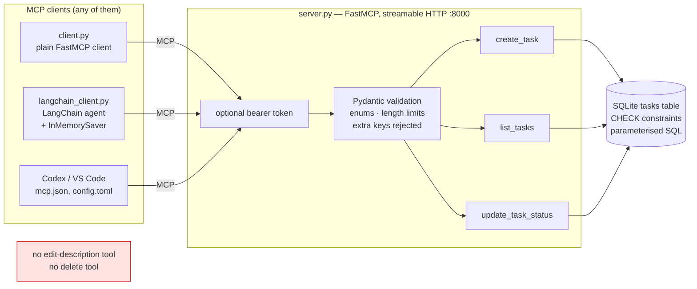
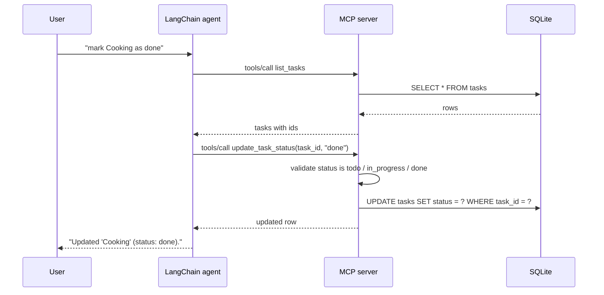

# MCP Task Server — build an MCP server once, use it from any client

> **Recruiter summary.** A small to-do list exposed as a Model Context Protocol (MCP) server, then used
> by three different clients: a plain FastMCP script, a LangChain agent, and IDE agents (Codex, VS Code).
> The point it proves is **least privilege**: the agent gets exactly three tools and nothing else, so it
> *cannot* edit a description even when asked. Proof: <!-- tests:51 -->**51 passing pytest tests**
> (measured), including prompt-injection cases and a real HTTP run with bearer-token auth, all offline with no API key.

| | |
|---|---|
| Stack | Python 3.12 · uv · FastMCP 3.4 · MCP SDK 1.x · SQLite · Pydantic 2 · LangChain 1.x + langchain-mcp-adapters · LangGraph checkpointer |
| Transport | Streamable HTTP on `127.0.0.1:8000/mcp` (loopback by default) |
| Status | Learning project and reference build. Runs locally. Not deployed anywhere. |
| Numbers | Every figure here comes from a real run in this repo and is labelled **measured** or **simulated**. |

## Read in this order

| # | File | What you get |
|---|---|---|
| 0 | `README.md` | This page: summary, architecture, how to run |
| 1 | [`docs/01-what-is-mcp.md`](docs/01-what-is-mcp.md) | MCP cheat sheet: hosts, clients, servers, tools, resources, prompts, transports |
| 2 | [`LEARNING_GUIDE.md`](LEARNING_GUIDE.md) | 12-step build-it-yourself walkthrough |
| 3 | [`docs/02-implementation-guide.md`](docs/02-implementation-guide.md) | How to adopt the pattern for your own data |
| 4 | [`docs/03-interview-points.md`](docs/03-interview-points.md) | MCP vs function calling, transports, security — interview answers |
| 5 | [`docs/04-threat-model.md`](docs/04-threat-model.md) | STRIDE + OWASP LLM Top 10 mapping |
| 6 | [`docs/05-built-vs-planned.md`](docs/05-built-vs-planned.md) | Honest status table |
| 7 | [`docs/06-connect-codex-vscode.md`](docs/06-connect-codex-vscode.md) | Add the server to Codex and VS Code |
| 8 | [`USE_CASES.md`](USE_CASES.md) | Where this pattern fits in real work |
| 9 | [`PRESENTATION_GUIDE.md`](PRESENTATION_GUIDE.md) | A 10-minute talk track for demos and interviews |
| — | [`docs/adr/`](docs/adr/) | Architecture decisions |

## Purpose and who it is for

- **Learners** who want to understand MCP by building one server and three clients by hand.
- **Engineers** who need a small, tested template for exposing an internal system to agents safely.
- **Reviewers and recruiters** who want to see agent security handled in code and tests, not only in slides.

## Architecture



## How it works, step by step



1. `database.py` creates one table. Status and priority are limited by `CHECK` constraints, and every query uses `?` placeholders.
2. `server.py` builds a FastMCP app with three tools. Their type hints (`Literal`, `Annotated[..., Field]`) become the JSON Schema that clients see.
3. A client connects over streamable HTTP, asks `tools/list`, and calls tools by name.
4. The LangChain client turns the MCP tools into LangChain tools with `load_mcp_tools` and gives them to `create_agent`.
5. Without `OPENAI_API_KEY`, the agent uses `FakeTaskModel`, a rule-based test double. With a key, it uses a real chat model.

## Real code and real output

The tool that changes status (from `server.py`):

```python
@mcp.tool(name="update_task_status", description="Change the status of one task. Only the status can change.")
def update_task_status(
    task_id: Annotated[str, Field(description="The id returned by create_task", max_length=64)],
    status: Annotated[Status, Field(description="todo, in_progress or done")],
) -> dict:
    try:
        return db.update_status(task_id, status, db_path=db_path)
    except db.TaskNotFoundError:
        raise ToolError("Task not found. Call list_tasks to see valid task ids.") from None
```

Output of `uv run python scripts/run_demo.py` (measured, saved in `results/demo_output.txt`):

```text
== plain FastMCP client ==
Tools: create_task, list_tasks, update_task_status
Created: Write MCP notes todo
Updated: Write MCP notes in_progress
- Write MCP notes [high] in_progress

== LangChain agent (offline fake model) ==
you> add task MCP runbook
agent> Created 'MCP runbook' (status: todo).
you> mark MCP runbook as done
agent> Updated 'MCP runbook' (status: done).
you> change the description of MCP runbook to something else
agent> I can't do that. This server only lets me create tasks, list them and change their status.
you> list tasks
agent> Your tasks:
- Write MCP notes [high] - in_progress
- MCP runbook [medium] - done

== latency, list_tasks over loopback HTTP (measured, n=50) ==
median 4.30 ms, p95 4.89 ms
```

The latency line is one measured run on an 8-vCPU Linux box over loopback. It is a sanity check, not a benchmark, and it will differ on your machine.

## How to run

**Offline first (no key, no network after install):**

```bash
uv sync                                  # installs Python 3.12 deps from uv.lock
uv run pytest                            # 51 tests
uv run python server.py                  # terminal 1: http://127.0.0.1:8000/mcp
uv run python client.py                  # terminal 2: plain client
uv run python langchain_client.py        # terminal 2: chat with the offline agent
```

**Optional real model:** `export OPENAI_API_KEY=...` before `langchain_client.py`. The key is read from the environment only and never written to disk by this code.

**Optional auth:** `export MCP_AUTH_TOKEN=$(python -c "import secrets;print(secrets.token_urlsafe(32))")` in both terminals. The server then returns `401` to any request without `Authorization: Bearer <token>`.

**IDE agents:** see [`docs/06-connect-codex-vscode.md`](docs/06-connect-codex-vscode.md). `mcp.json` and `.vscode/mcp.json` are ready for VS Code; `codex/config.toml.example` is ready for Codex.

## Guardrails and security controls

| Control | Where | Proven by |
|---|---|---|
| Only three tools; no edit-description, no delete | `server.py` | `tests/test_least_privilege.py` |
| `status` and `priority` are enums (schema + DB `CHECK`) | `server.py`, `database.py` | `test_status_injection_rejected`, `test_check_constraint_*` |
| Title 1–120 chars, description ≤ 1000, whitespace trimmed | `NewTask` Pydantic model | `test_bad_titles_rejected`, `test_description_limit` |
| Unknown arguments rejected (`additionalProperties: false`) | FastMCP schema | `test_update_status_rejects_smuggled_description` |
| Parameterised SQL only | `database.py` | `test_sql_injection_text_is_stored_as_plain_data` |
| Clear not-found error that does not echo input | `update_task_status` | `test_not_found_error_is_clear` |
| Our validation errors name the field, not the value | `create_task` | `test_validation_error_does_not_echo_input` |
| Bind to `127.0.0.1` by default | `server.main()` | `test_default_bind_is_loopback` |
| Optional bearer token, constant-time compare | `bearer_auth_from_env()` | `test_http_without_token_is_401`, `test_http_wrong_token_is_401` |
| Task text treated as data, not instructions | system prompt + fake model design | `tests/test_prompt_injection.py` |
| No secrets in the repo | `.env.example`, `.gitignore`, gitleaks in CI | CI `secrets` job |

**Why there are no secrets in this repo:** nothing here needs one to run. The model key and the bearer token are optional and are read from environment variables at start-up. `.env` is git-ignored, `.env.example` holds names only, Codex is given the *name* of a variable (`bearer_token_env_var`), and CI runs gitleaks over the full history on every push.

## Limitations and known failures

- **The fake model is not an LLM.** It reads only the user's words with fixed patterns. The injection tests show the *server* holds its limits; they do not show how a real model reacts to hostile text.
- **Pydantic errors raised by FastMCP itself echo the bad value** (for example an invalid `status`). Only errors raised in our own code are scrubbed. Kept visible in `docs/04-threat-model.md`.
- **The static bearer token is a learning control,** not production auth: no rotation, no scopes, no per-user identity. Use OAuth 2.1 / Entra ID for real deployments.
- **SQLite with one file** is fine for one user, not for concurrent multi-user writes.
- No rate limiting, no audit log table, no human approval step yet (see the planned items).

## Built vs planned

| Item | Status |
|---|---|
| SQLite layer, three MCP tools, streamable HTTP | Built and tested |
| Plain FastMCP client, LangChain agent with checkpointer, offline fake model | Built and tested |
| Bearer-token auth, loopback bind, Pydantic limits | Built and tested |
| `mcp.json` (VS Code), Codex `config.toml` example | Written; not run in CI (needs the IDE) |
| Real-model run (`OPENAI_API_KEY`) | Written, not run in CI (no key by design) |
| OAuth 2.1 / Entra ID auth, rate limiting, audit log, human-approval tool | Planned |
| Cloud deployment | Planned only; nothing billable created |

Full table: [`docs/05-built-vs-planned.md`](docs/05-built-vs-planned.md).

## CI

GitHub Actions (`.github/workflows/ci.yml`, actions pinned to full SHAs): `uv sync --locked`, ruff, the full test suite via `scripts/count_tests.py` (prints the real total), `scripts/docs_check.py` (README test counts must match a fresh collection), a hashed brand-name check, and gitleaks over full history. CodeQL runs in `codeql.yml`.

## Related repos

- [Jagadish-agent-identity-security](https://github.com/jagadishmazure-jpg/Jagadish-agent-identity-security) — identity for agents, the production version of the token here
- [Jagadish-agent-auth-security](https://github.com/jagadishmazure-jpg/Jagadish-agent-auth-security) — OAuth and delegated auth patterns
- [Jagadish-langchain-langgraph-langsmith](https://github.com/jagadishmazure-jpg/Jagadish-langchain-langgraph-langsmith) — deeper LangChain / LangGraph scenarios
- [Jagadish-agent-memory-defense](https://github.com/jagadishmazure-jpg/Jagadish-agent-memory-defense) — defending agent memory from injected content

## License

MIT — see [`LICENSE`](LICENSE).
