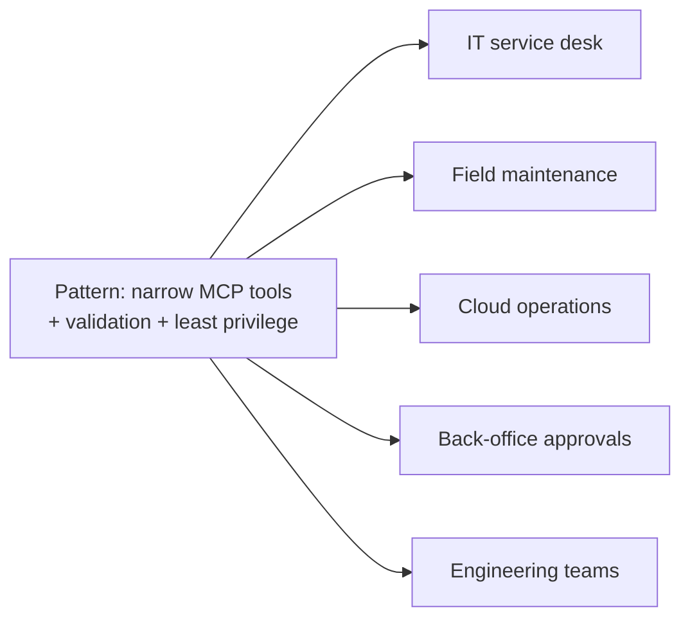

# Use cases

The task list is a stand-in. The pattern — narrow tools, limits in the schema and the data layer, one server for many clients — carries over directly. Company names below are fictional.

| # | Scenario (fictional) | Tools you would publish | Deliberately **not** published | Why MCP |
|---|---|---|---|---|
| 1 | **Northfield Utilities** service desk: agents triage tickets | `create_ticket`, `list_my_tickets`, `set_ticket_state` | close-without-note, reassign-to-anyone | Same tools from the chat bot, the IDE and the on-call script |
| 2 | **Bluepeak Rail** field crews log defects from a tablet agent | `log_defect`, `list_open_defects`, `mark_inspected` | edit inspection history | Offline-tolerant, auditable, narrow |
| 3 | **Larkspur Cloud** platform team checks resource state | `list_resource_groups`, `get_cost_summary` | create or delete resources | Read-only agents first; write tools later behind approval |
| 4 | **Harbor & Finch** finance back office tracks invoice status | `list_invoices`, `set_invoice_status` (enum) | change amounts or payees | Status changes are safe; money fields are not exposed |
| 5 | Any engineering team's sprint board | `create_task`, `list_tasks`, `update_task_status` | delete, rewrite history | Exactly this repo |

## When **not** to use this pattern

- One app, two functions, no reuse — plain function calling is simpler.
- Actions that need a human every time — build the approval flow first, then expose a "request" tool.
- High-volume, latency-critical paths — the extra process and hop add cost (here: median 4.30 ms per call on loopback, measured, n=50).
