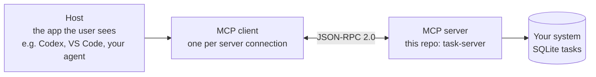
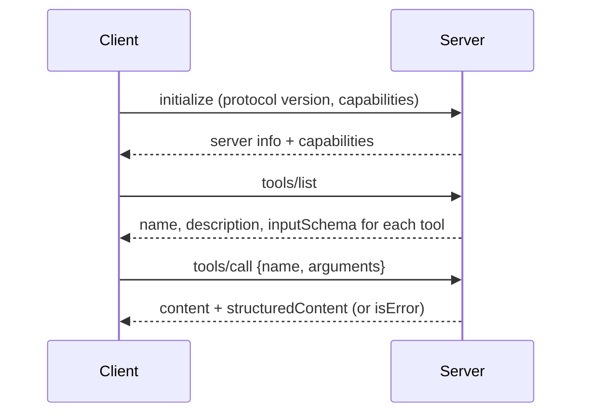
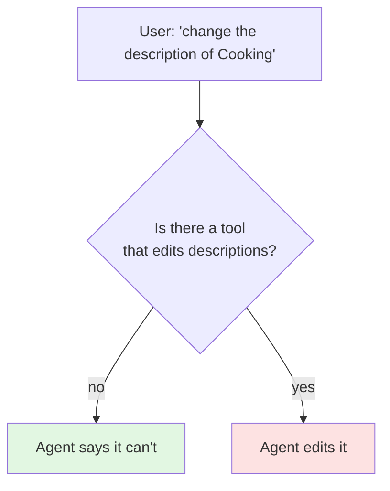

# 01 — What is MCP? (cheat sheet)

**One line:** the Model Context Protocol is a standard way for an AI application to discover and call
capabilities that live somewhere else — your database, your file system, your ticketing system — without
writing a custom integration for every pairing of app and system.

## The three roles

| Role | What it does | In this repo |
|---|---|---|
| **Host** | The application holding the model and the conversation | `langchain_client.py`, Codex, VS Code |
| **Client** | Keeps one connection to one server, speaks the protocol | `fastmcp.Client` |
| **Server** | Publishes capabilities and runs them | `server.py` |

## The three things a server can offer

| Primitive | Who decides to use it | Think of it as | Example |
|---|---|---|---|
| **Tools** | The **model** chooses to call them | Functions with side effects | `create_task`, `update_task_status` |
| **Resources** | The **application** chooses to load them | Read-only documents by URI | `tasks://summary` (planned) |
| **Prompts** | The **user** picks them | Reusable message templates | "Plan my week" (planned) |

This repo uses tools only, because the lesson is about controlling what an agent can *do*.

## The life of one tool call

The model never sees your Python. It sees the **name, description and JSON Schema** of each tool. Good names
and descriptions are therefore part of the interface, not decoration.

## Transports

| Transport | How it travels | Use it when | Watch out for |
|---|---|---|---|
| **stdio** | Host starts the server as a child process; messages on stdin/stdout | Local, single-user tools | Never print to stdout from the server; it corrupts the stream |
| **Streamable HTTP** | One HTTP endpoint (`/mcp`); POST for requests, optional SSE stream for server messages | Shared or remote servers; this repo | Bind address, auth, origin checks |
| **SSE (legacy)** | Separate SSE endpoint plus POST endpoint | Only for older clients | Replaced by streamable HTTP in newer spec versions |

## MCP vs plain function calling

| | Function calling | MCP |
|---|---|---|
| Where tools are defined | Inside each app's code | In a separate server, once |
| Who can use them | That one app | Any MCP-capable host |
| Discovery | Hard-coded list | `tools/list` at run time |
| Process boundary | Same process | Separate process or machine |
| Relationship | MCP **uses** function calling underneath: the host still hands the model a tool list | |

## Least privilege, in one picture

The safest permission is the one you never publish. This server publishes no edit or delete tool, and a test
checks that the agent's request leaves the database unchanged.

## Words to know

- **JSON-RPC 2.0** — the message format (`id`, `method`, `params`, `result` / `error`).
- **inputSchema** — the JSON Schema for a tool's arguments, generated here from Python type hints.
- **structuredContent** — machine-readable result next to the text result.
- **Session** — a client-server connection after `initialize`; streamable HTTP tracks it with a session header.

Next: [`../LEARNING_GUIDE.md`](../LEARNING_GUIDE.md).
