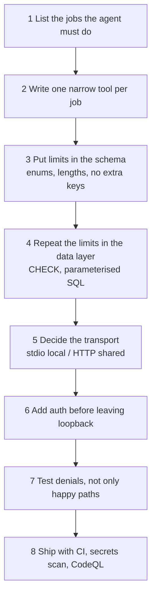

# 02 — Implementation guide (adopt the pattern for your own system)

Use this when you want to put **your** data behind an MCP server for agents.

## 1. Start from the jobs, not the tables

| Ask | Example answer here |
|---|---|
| What should the agent be able to do? | Create tasks, read tasks, move a task between states |
| What must it **never** do? | Edit descriptions, delete tasks, change priority after creation |
| Which actions need a human? | None today; a `delete_task` would need approval (planned) |

Write a tool for each "should" and **nothing** for each "never".

## 2. Tool design checklist

- [ ] `snake_case` verb_noun name (`update_task_status`, not `update`).
- [ ] One-sentence `description` that says what changes and what does not.
- [ ] Every argument typed; choices as `Literal[...]`; free text with `max_length`.
- [ ] Returns a plain `dict` / `list[dict]` so `structuredContent` is filled.
- [ ] Errors raised as `ToolError` with a next step ("Call list_tasks ...").
- [ ] Error text names fields, never echoes values.

## 3. File map to copy

| File | Keep | Replace |
|---|---|---|
| `database.py` | Placeholder pattern, `closing()` + transaction, not-found error | Schema and queries |
| `server.py` | `build_server()` factory, `bearer_auth_from_env()`, loopback default | The three tools |
| `client.py` | Structure | Calls |
| `langchain_client.py` | `load_mcp_tools` + `create_agent` + checkpointer | System prompt |
| `fake_model.py` | Idea: deterministic offline model for CI | Rules for your phrases |
| `tests/` | Least-privilege, injection, HTTP auth tests | Data |

## 4. Configuration (all optional)

| Variable | Default | Purpose |
|---|---|---|
| `TASKS_DB_PATH` | `tasks.db` | SQLite file |
| `MCP_HOST` | `127.0.0.1` | Bind address. Change only behind a reverse proxy with TLS |
| `MCP_PORT` | `8000` | Port |
| `MCP_AUTH_TOKEN` | unset | Turns on bearer-token auth |
| `OPENAI_API_KEY` | unset | Real model for `langchain_client.py` |
| `OPENAI_MODEL` | `gpt-4o-mini` | Model name when the key is set |

## 5. Moving beyond a laptop

| Concern | Learning build | Production direction |
|---|---|---|
| Auth | Static bearer token | OAuth 2.1 with an identity provider (for example Entra ID), per-user scopes |
| Storage | SQLite file | Managed Postgres / Azure SQL with row-level ownership |
| Network | Loopback | TLS reverse proxy, private networking, allowed origins |
| Audit | None | Append-only log of every tool call with caller id |
| Risky actions | Not exposed | Separate tool requiring human approval |
| Hosting | Local process | Container on Azure Container Apps or AKS (planned; nothing deployed, no cost incurred) |

## 6. Done means

`uv run pytest` green, `ruff check .` clean, docs check passes, gitleaks clean, and a denial test exists for
every "never" in step 1.
