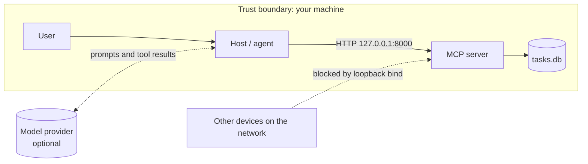

# 04 — Threat model

Scope: `server.py` on a developer machine, reached by local MCP clients over streamable HTTP, storing data in one SQLite file.

## STRIDE

| Threat | Example | Control in this repo | Test | Residual risk |
|---|---|---|---|---|
| **S**poofing | Another local process calls the server | Optional bearer token, constant-time compare | `test_http_without_token_is_401`, `test_http_wrong_token_is_401` | Static token, no per-user identity |
| **T**ampering | Agent edits a description | No such tool; `UPDATE` only touches `status` | `tests/test_least_privilege.py` | A future tool could widen this; review every new tool |
| **T**ampering | SQL injection via title or id | Placeholders, `CHECK` constraints | `test_sql_injection_*`, `test_task_id_injection_hits_nothing` | — |
| **R**epudiation | "I didn't mark that done" | None yet | — | **Open:** no audit log (planned) |
| **I**nformation disclosure | Error echoes a pasted secret | Our errors name fields only | `test_validation_error_does_not_echo_input` | **Known:** FastMCP's own enum errors echo the bad value |
| **I**nformation disclosure | Server reachable from LAN | Default bind `127.0.0.1` | `test_default_bind_is_loopback` | User can override `MCP_HOST` |
| **D**enial of service | Huge titles / ids | Length limits (120 / 1000 / 64) | `test_bad_titles_rejected`, `test_oversized_task_id_rejected` | No rate limit (planned) |
| **E**levation of privilege | Agent sets status `done` at create time | `status` not an argument of `create_task`; SQL hard-codes `'todo'` | `test_create_task_cannot_set_status` | — |

## OWASP Top 10 for LLM applications (2025) — relevant items

| Risk | How it shows up here | Mitigation |
|---|---|---|
| LLM01 Prompt injection | Hostile text stored in a task and read back by the agent | Server-side limits hold regardless of what the model decides; system prompt marks task text as data |
| LLM02 Sensitive information disclosure | Errors or results leaking secrets | No secrets stored; errors scrubbed in our code |
| LLM05 Improper output handling | Model output used as SQL | Model output only ever reaches SQL as a bound parameter |
| LLM06 Excessive agency | Agent given broad write access | Three narrow tools; no edit or delete |
| LLM10 Unbounded consumption | Very large inputs | Length limits; rate limiting planned |

## Known failures kept visible

1. FastMCP's built-in validation message for a bad enum includes the input value.
2. The offline fake model cannot be "fooled", so injection tests do not measure real-model robustness.
3. No audit trail and no rate limiting.
