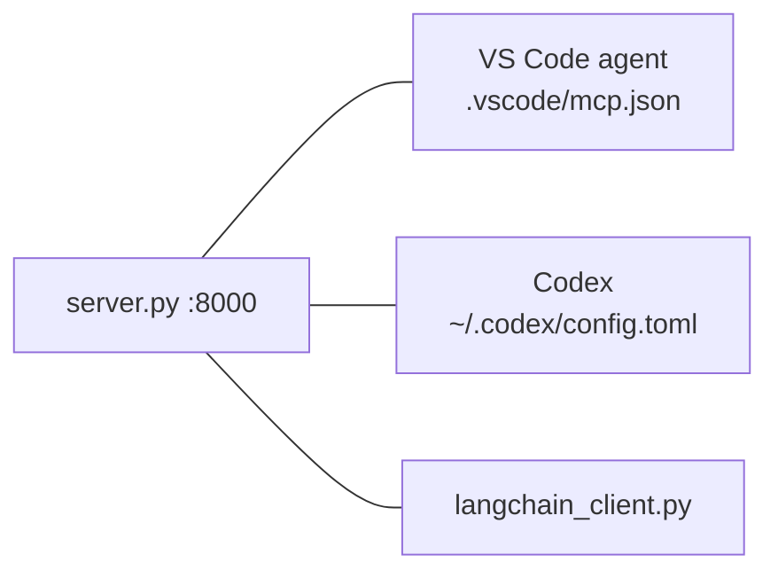

# 06 — Connect Codex and VS Code

Both IDEs talk to the **already running** HTTP server. Start it first:

```bash
uv run python server.py        # http://127.0.0.1:8000/mcp
```



## VS Code

The repo ships `.vscode/mcp.json` (same content as root `mcp.json`):

```json
{ "servers": { "task-server": { "type": "http", "url": "http://127.0.0.1:8000/mcp" } } }
```

1. Open the folder in VS Code. 2. Run **MCP: List Servers** and start `task-server`. 3. In agent chat, ask "list my tasks".

## Codex

Copy `codex/config.toml.example` into `~/.codex/config.toml`:

```toml
[mcp_servers.task-server]
url = "http://127.0.0.1:8000/mcp"
bearer_token_env_var = "MCP_AUTH_TOKEN"
```

- Remove the `bearer_token_env_var` line if you did not set a token.
- If you did, export `MCP_AUTH_TOKEN` in the shell that starts Codex. The config holds the **name** of the variable, never the token.
- Check with `codex mcp list`, then ask Codex to list or create tasks.

## Try the least-privilege demo

Ask the IDE agent to "change the description of Cooking". It has no tool to do it, so it should say so. Confirm
with `uv run python client.py` that the description is unchanged.

Status: these configs are written and match the documented formats, but are **not run in CI** because CI has no IDE.
